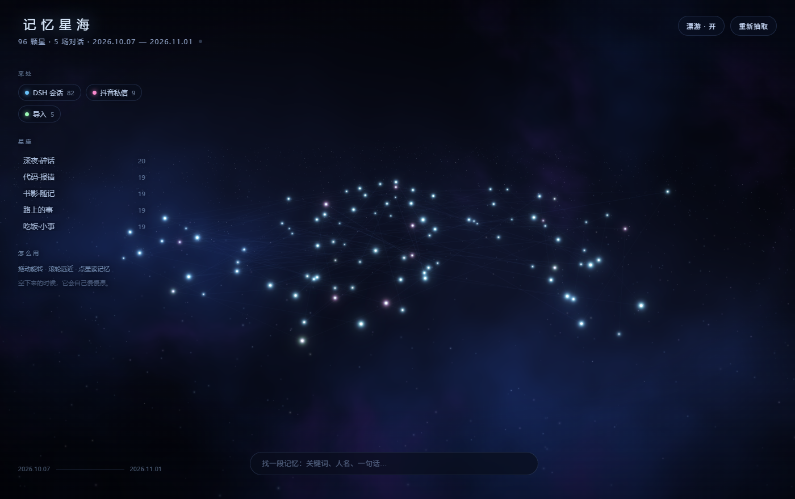

# 记忆星海 · Memory Star Sea

> 把和 AI 聊过的字，摊成一片能漂游的星海。
> 一条记忆一颗星，时间越久越远；说得像的事会自己连成星座。



一个 [DeepSeek Harness](https://github.com/deepseek-ai) 插件：把本地的聊天记录抽成一片 3D 星海，
侧边栏一点就开。数据不出这台电脑。

---

## 它是什么

你在 DSH 里说过的每一轮对话，都会变成星海里的一颗星：

- **位置**由「说的是什么」决定 —— 语义相近的星自然挨在一起，连成星座；
- **远近**由时间决定 —— 越久远的记忆越靠外，整片海因此有了方向感；
- **亮度**由这句话的浓度决定 —— 感叹号、笑声、长句子，会亮一点。

点开一颗星，能看到那天你说了什么、AI 当时怎么回的。

因为记录一直在写，所以星海也一直在长：你说一句，过几秒那边就多一颗，
页面不用刷新，新星会从暗处亮起来。

## 安装

### 作为 DSH 插件（推荐）

```bash
dsh plugin --profile desktop add link:<本仓库路径>
```

然后确认 `~/.dsh/profiles/desktop/package.json` 的 `dsh.profile.bundles` 里有 `dsh-memory-starsea`，
重启 DeepSeek Harness，侧边栏底部会出现一个星形入口。

Windows 上也可以直接双击 `修复星海入口.cmd`，它会把本仓库拷进 profile 并完成全部登记。

> 为什么需要登记：pnpm 每次装/卸插件都会对账，没写进 `dependencies` 的目录会被当成多余文件清掉。

### 独立运行

```bash
node starsea/server.mjs
# 打开 http://127.0.0.1:7788
```

Windows 双击 `start.cmd`。没有 npm 依赖，不需要构建。

## 怎么用

| 动作 | 效果 |
| --- | --- |
| 拖拽 / 滚轮 | 转动星海、拉近拉远 |
| 点一颗星 | 读那段记忆 |
| 顶部搜索 | 打关键词，命中的星亮起，其余暗下去 |
| 左侧「星座」 | 只看某一团 |
| 空格 | 漂游开关（空下来它会自己慢慢转） |
| `?star=42` | 把某一颗星单独分享出去 |

## 它是怎么做的

不靠任何模型，纯本地、纯前端：

1. **切词**：用系统自带的 ICU 中文分词（`Intl.Segmenter`），切出来是「检索」「文献」这样的真词；
2. **向量**：TF-IDF，再用哈希随机投影压到两个轴上 —— 语义相近的自然靠近；
3. **摊平**：横向 = 语义主轴，投影本身近似正态，所以中间天然密、两边越走越稀；
   纵向压到很薄（±2），纵深留给「时间」——越久远越靠里。远看就是一条横着铺开的星带；
4. **星流**：整片海绕中心顺时针旋转，内圈比外圈快一点，约 8.7 分钟一圈；
5. **星座**：k-means 聚类起名，加上「同一场对话相邻」的连线；
6. **渲染**：原生 WebGL2 点精灵 + 加法混合 + 廉价泛光，几千颗星也不卡。

坐标系锚点存在 `starsea.json` 的 `layout` 里，**新星只往边上长，旧星不会挪窝**。

## 数据在哪

```
~/.dsh/memory-starsea/
├─ starsea.json   抽出来的星图（可删，会自动重算）
├─ server.pid     运行中的进程号
├─ inbox/         往这里丢导出的聊天记录（.json / .jsonl）
└─ launch.log     启动与自动重抽的记录
```

来源：

- DSH 会话（`~/.dsh/sessions/**/session.v4.jsonl.zstd`，逐帧 zstd 解）
- 抖音私信的本地记忆（`~/.dsh/douyin-duty/memory/*.json`）
- 手动导入（`inbox/`）

**隐私**：服务只监听 `127.0.0.1`，不联网、不上传；除聊天记录外不读任何东西。

## 目录

```
.
├─ index.js            服务端插件：启动时拉起星海服务
├─ client.js           客户端：侧边栏入口 + 面板
├─ cordis.patch.yml    挂进 DSH 的配置树
├─ starsea/
│  ├─ server.mjs       本地服务（静态 + API + SSE）
│  ├─ ingest.mjs       抽取管线（会话 → 星）
│  └─ web/             前端（原生 WebGL2，零依赖）
├─ tools/              安装、自检、图标等开发脚本
└─ docs/               截图与图标
```

## 开发

```bash
node tools/check-plugin.mjs   # 模拟宿主把插件跑一遍：语法、注册、渲染
node starsea/ingest.mjs       # 只跑抽取，看星图数据
node tools/test-live.mjs      # 验证「文件一变就重抽并推送」
```

## License

MIT
